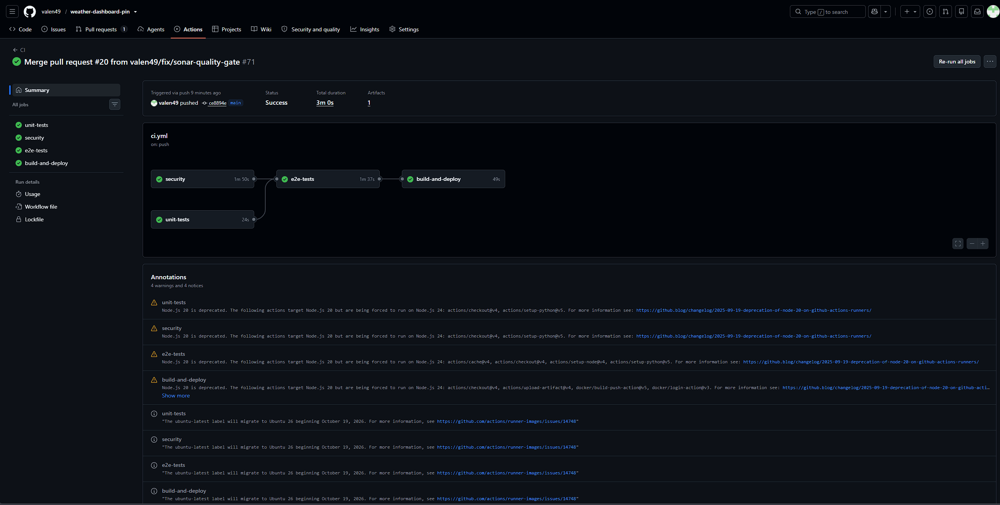
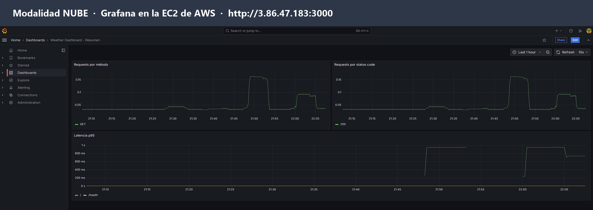
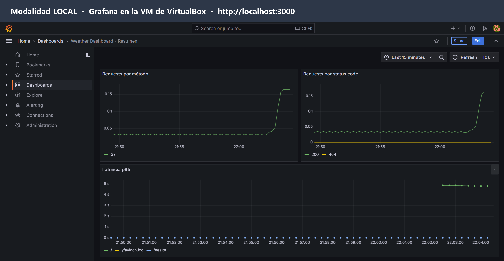
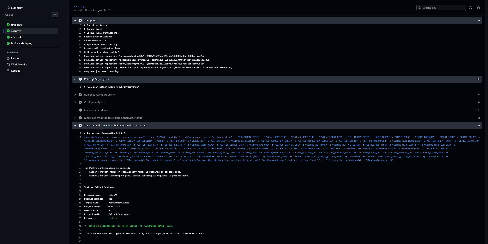
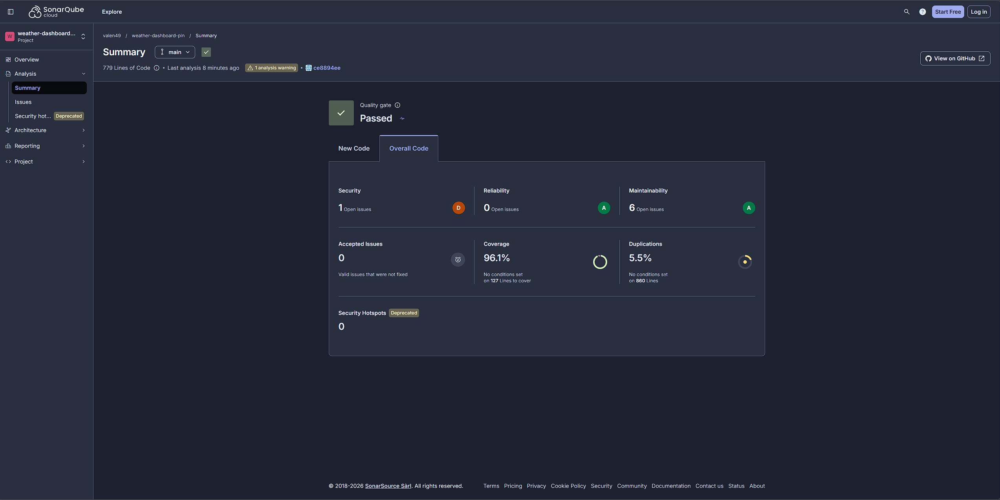

# 🌤️ Weather Dashboard — PIN

Proyecto Integrador Final (PIN) del curso **DevOps** de **mundosE** (UNC/FCEFyN) —
**Proyecto 1: CI/CD con GitHub Actions + Terraform + Docker**. Grupo 10 — trabajo individual de
Valentín Vidal.

Dashboard de clima en Flask que consume la API pública y gratuita de [Open-Meteo](https://open-meteo.com/)
para mostrar el clima actual y el pronóstico de 7 días de cualquier ciudad del mundo. La aplicación en sí
es el "sujeto de prueba" sobre el que se construye todo el pipeline de CI/CD, la infraestructura como
código y el stack de observabilidad que pide la consigna del PIN.

## 📖 La historia de este proyecto

Durante el curso llevé en paralelo dos repos con propósitos distintos: **`devops-curso`**, un repo
teórico-práctico donde iba resolviendo los laboratorios y ejercicios de cada encuentro tal cual los pedía
la cursada, y **`weather-dashboard`**, un repo 100% práctico que arranqué por mi cuenta para ir
integrando todo lo que aprendía sobre una aplicación real: pipelines de CI/CD, contenedores, Kubernetes,
infraestructura como código, seguridad, observabilidad. La idea siempre fue tener algo concreto para
mostrar en entrevistas de trabajo al terminar el curso, no solo ejercicios sueltos.

En el camino llegué a correr un Jenkins self-hosted en una mini PC propia, desplegando a un clúster de
Kubernetes local — una forma de practicar un pipeline completo sin depender de servicios en la nube. Esa
etapa quedó documentada en el historial de commits del repo original.

Cuando llegó el momento del PIN y tocó elegir uno de los 4 proyectos posibles, elegí el **Proyecto 1**
(GitHub Actions + Terraform + Docker, con despliegue en AWS). Le había agarrado cariño al
`weather-dashboard` original —no quería tocarlo ni perder ese historial—, así que en vez de modificarlo
in situ, lo **cloné completo** (con todos los commits) a este repo, `weather-dashboard-pin`, y acá es
donde se hizo toda la limpieza, el ajuste de infraestructura y la alineación 1 a 1 con la rúbrica del
Proyecto 1. El original sigue intacto como estaba.

> La idea de la aplicación base (Flask + Open-Meteo) surgió de una sugerencia de un asistente de IA
> (ChatGPT o Claude) apenas arrancado el curso. De ahí en adelante, tanto `devops-curso` como
> `weather-dashboard` y este mismo repo se desarrollaron con asistencia de **Claude Code** (integración
> con VS Code, plan pago básico), evolucionando sprint a sprint sobre esa base inicial.

## ✨ Features

- 🔍 **Búsqueda por ciudad**: clima en tiempo real por nombre de ciudad
- 🌍 **Filtro por país** (opcional): desambigua ciudades con el mismo nombre (Londres, Reino Unido vs.
  Londres, Argentina). Acepta el nombre en español o el código de 2 letras (`GB`, `AR`)
- 🌙 **Modo nocturno**: se recuerda entre visitas y respeta la preferencia del sistema operativo
- 🌡️ **Condiciones actuales**: temperatura, velocidad del viento y estado del clima
- 📅 **Pronóstico a 7 días**: predicción extendida
- 🔄 **Toggle de unidad**: cambiar entre Celsius y Fahrenheit
- ⚖️ **Comparación de ciudades**: comparar el clima entre dos ubicaciones
- 🌦️ **Íconos dinámicos**: según el código de clima WMO
- 📱 **Diseño responsive**: optimizado para mobile, tablet y desktop
- 📍 **Ciudad por defecto**: Mendoza, Argentina, cuando no se busca ninguna

## 🏗️ Arquitectura

```
┌──────────────┐     push a main      ┌──────────────────────┐
│   GitHub     │ ───────────────────► │   GitHub Actions      │
│   Actions    │                      │   (unit + security en │
│   (CI/CD)    │                      │   paralelo → e2e →    │
│              │                      │    build&deploy)      │
└──────────────┘                      └───────────┬───────────┘
                                                    │
                        ┌───────────────────────────┼───────────────────────────┐
                        ▼                            ▼                           ▼
                ┌───────────────┐           ┌────────────────┐         ┌─────────────────┐
                │  GHCR         │           │  SBOM           │         │  Snyk +          │
                │  (imagen      │           │  CycloneDX      │         │  SonarQube Cloud │
                │   Docker)     │           │  (artifact)     │         │  (deps + código)  │
                └───────┬───────┘           └────────────────┘         └─────────────────┘
                        │ docker pull / deploy por SSH
                        ▼
        ┌──────────────────────────────────────────────────┐
        │  EC2 (AWS, provisionada con Terraform)             │
        │                                                     │
        │  ┌───────────────┐   scrape /metrics   ┌──────────┐│
        │  │ weather-       │ ◄─────────────────── │Prometheus││
        │  │ dashboard      │                       └────┬─────┘│
        │  │ (Flask, :5000) │                            │       │
        │  └───────────────┘                       ┌────▼─────┐│
        │                                            │ Grafana  ││
        │                                            │ (:3000)  ││
        │                                            └──────────┘│
        └──────────────────────────────────────────────────┘
```

## 🛠️ Stack (herramientas exigidas por el Proyecto 1, una por categoría)

| Categoría | Herramienta | Uso |
|---|---|---|
| **CI/CD** | GitHub Actions | `unit-tests` y `security` en paralelo → `e2e-tests` → `build-and-deploy` |
| **IaC** | Terraform | EC2 + Security Group en AWS, backend remoto en S3 + DynamoDB |
| **Contenedores** | Docker | Imagen de la app, publicada en GHCR |
| **Seguridad** | Snyk + SonarQube Cloud | Vulnerabilidades de dependencias + análisis estático de código |
| **Monitoreo** | Prometheus + Grafana | Scraping de `/metrics` + dashboard de métricas |

Más abajo, el resto del stack de la aplicación en sí:

| Componente | Tecnología |
|---|---|
| Backend | Python 3.11 + Flask |
| Frontend | HTML5 + CSS3 + JavaScript (sin frameworks) |
| API de clima | Open-Meteo (gratuita, sin API key) |
| Tests unitarios | pytest |
| Tests E2E | Playwright (Page Object Model) |

## 🚀 Quick start (desarrollo local)

### Requisitos
- Docker y Docker Compose
- Python 3.11+ (para desarrollo sin contenedores)
- Node.js 20+ (para correr los tests E2E)

```bash
git clone https://github.com/valen49/weather-dashboard-pin.git
cd weather-dashboard-pin

# Con Docker Compose (recomendado)
docker compose up --build
```

Abrir `http://localhost:5000`.

```bash
# O corriendo localmente sin Docker
python -m venv venv
source venv/bin/activate      # Linux/Mac
# venv\Scripts\activate       # Windows
pip install -r requirements.txt -r requirements-dev.txt
python run.py
```

### Tests

```bash
# Tests unitarios
pytest tests/ -v

# Tests E2E
npm ci
npx playwright install chromium --with-deps
npx playwright test --project=chromium
```

## 🐳 Docker

```bash
# Build de la imagen de la app
docker build -t weather-dashboard:latest .

# Build de la imagen de E2E
docker build -f Dockerfile.e2e -t weather-dashboard-e2e:latest .

# Correr la app sola
docker run -p 5000:5000 weather-dashboard:latest
```

El `Dockerfile` usa `python:3.11-slim`, corre como usuario no-root, y define un `HEALTHCHECK` contra
`/health`.

## 🔄 Pipeline de CI/CD (GitHub Actions)

Workflow en [`.github/workflows/ci.yml`](.github/workflows/ci.yml), con 4 jobs encadenados:

1. **`unit-tests`**: instala dependencias y corre `pytest tests/ -v`.
2. **`security`** (en PR o push a `main`): escaneo de dependencias con **Snyk** y análisis estático de
   código con **SonarQube Cloud**.
3. **`e2e-tests`** (depende de `unit-tests`): levanta la app y corre los tests de Playwright contra ella.
4. **`build-and-deploy`** (depende de `e2e-tests` y `security`, solo en push a `main`):
   - build y push de la imagen Docker a GHCR (`ghcr.io/valen49/weather-dashboard-pin`)
   - generación del **SBOM** en formato CycloneDX (subido como artifact del workflow)
   - deploy por SSH a la EC2: `docker pull` + `docker run` de la imagen nueva, con health check contra `/health`
   - copia del stack de `monitoring/` a la EC2 y `docker compose up -d` para levantar Prometheus + Grafana



## ☁️ Infraestructura (Terraform)

El proyecto cubre las dos modalidades de despliegue que plantea la consigna, cada una con su propio
módulo de Terraform:

| Modalidad | Carpeta | Dónde corre | Infraestructura | Deploy de la app |
|---|---|---|---|---|
| **Nube** | [`terraform/`](terraform/) | EC2 en AWS | `terraform apply`, una vez | Automático: cada push a `main`, GitHub Actions despliega por SSH |
| **Local** | [`terraform-local/`](terraform-local/) | VM Ubuntu en VirtualBox | `terraform apply` | Manual: el mismo `terraform apply` despliega la app |

Las dos levantan lo mismo: la imagen publicada en GHCR más el stack de Prometheus + Grafana.

### Nube (AWS)

Todo en [`terraform/`](terraform/):

- `providers.tf`: provider de AWS (`us-east-1`) y backend remoto del state en S3 + DynamoDB (para lock).
- `ec2.tf`: instancia EC2 `t2.micro` (Ubuntu 22.04), con Docker y el plugin de Docker Compose
  instalados vía `user_data` (Compose se baja directo del binario oficial, no del paquete
  `docker-compose-plugin` de apt — ese no existe en los repos default de Ubuntu 22.04).
- `security_group.tf`: abre los puertos 22 (SSH, deploy desde GitHub Actions), 5000 (app), 3000 (Grafana)
  y 9090 (Prometheus).
- `outputs.tf`: IP pública de la instancia y comando de SSH listo para copiar/pegar.

```bash
cd terraform
terraform init
terraform plan
terraform apply
```

Detalle completo del setup (bootstrap del bucket de state, manejo de la keypair, etc.) en
[`terraform/README.md`](terraform/README.md).

### Local (VirtualBox)

Todo en [`terraform-local/`](terraform-local/). Terraform crea la VM con `VBoxManage` (la CLI nativa de
VirtualBox), instala Ubuntu Server 22.04 de forma desatendida y después entra por SSH para instalar
Docker y levantar la app y el monitoring. Los puertos quedan expuestos solo en `127.0.0.1`.

```bash
cd terraform-local
terraform init
terraform apply     # ~20 min la primera vez (instalación del SO)
terraform destroy
```

El pipeline de GitHub Actions **no** despliega a esta VM: un runner de GitHub corre en la nube y no
puede llegar a una máquina detrás de NAT en una red privada. Para traer una versión nueva hay que
repetir el `terraform apply`. Prerrequisitos y detalle en
[`terraform-local/README.md`](terraform-local/README.md).

## 📊 Observabilidad

La app expone métricas en formato Prometheus en `/metrics` (vía `prometheus-flask-exporter`). El stack de
[`monitoring/`](monitoring/) las scrapea y las visualiza:

- **Prometheus** (`:9090`): scrapea `/metrics` de la app (vía `host.docker.internal:5000`, ya que la
  app corre como contenedor standalone fuera de la red de `monitoring/`) cada 15s.
- **Grafana** (`:3000`): datasource de Prometheus y dashboard provisionados automáticamente al levantar
  el stack (no requiere configuración manual). El dashboard incluye 3 paneles: requests por método,
  requests por status code, y latencia p95 por endpoint.

| Nube (EC2 en AWS) | Local (VM en VirtualBox) |
|---|---|
|  |  |

Para correr el stack en local: copiar `monitoring/.env.example` a `monitoring/.env`, completar
`GRAFANA_ADMIN_USER`/`GRAFANA_ADMIN_PASSWORD`, y `docker compose -f monitoring/docker-compose.yml up -d`
(con la app ya corriendo en `:5000`). En el pipeline, esas mismas variables se inyectan desde GitHub
Secrets, no desde este archivo.

## 🔒 Seguridad

- **Snyk**: escaneo de vulnerabilidades en las dependencias de Python (`--severity-threshold=high`).
- **SonarQube Cloud**: análisis estático de código (bugs, code smells, duplicación) sobre `app/`.
- **SBOM**: generado en cada build con `anchore/sbom-action` (formato CycloneDX), subido como artifact
  del workflow.
- Imagen Docker corre con usuario no-root.
- Sin credenciales ni secretos hardcodeados en el código — todo vía GitHub Secrets.

| Snyk | SonarQube Cloud |
|---|---|
|  |  |

## 📁 Estructura del proyecto

```
weather-dashboard-pin/
├── app/                          # Aplicación Flask
│   ├── __init__.py               # App factory + métricas de Prometheus
│   ├── routes.py                 # Endpoints (/, /health)
│   ├── services.py                # Integración con Open-Meteo
│   └── templates/index.html      # UI
├── tests/                        # Tests unitarios (pytest)
├── e2e/                          # Tests E2E (Playwright, Page Object Model)
├── terraform/                    # Infraestructura como código (AWS)
├── terraform-local/              # Infraestructura como código (VirtualBox)
├── monitoring/                   # Prometheus + Grafana (docker-compose + provisioning)
├── docs/screenshots/              # Capturas: pipeline, Snyk, SonarCloud, Grafana
├── .github/workflows/ci.yml      # Pipeline de CI/CD
├── Dockerfile                    # Imagen de la app
├── Dockerfile.e2e                # Imagen para correr los tests E2E
├── docker-compose.yml            # Desarrollo local
└── README.md                     # Este archivo
```

## 📄 Licencia

MIT License — ver [LICENSE](LICENSE).

## 🙏 Agradecimientos

- [Open-Meteo](https://open-meteo.com/) por la API de clima gratuita
- [Flask](https://flask.palletsprojects.com/), [Playwright](https://playwright.dev/), [Docker](https://www.docker.com/), [Terraform](https://www.terraform.io/), [Prometheus](https://prometheus.io/) y [Grafana](https://grafana.com/)
- El curso **DevOps** de **mundosE** (UNC/FCEFyN) y su equipo docente

---

**Proyecto Integrador Final — Curso DevOps, mundosE, 2026**
